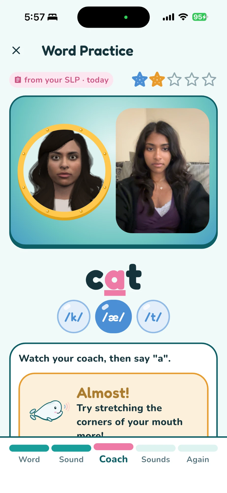

# echo-me

A speech practice app for kids. When a child misses a sound, an avatar shows how to make it and the phone's camera checks their lips on the next try.

Won **Most Technical** at [HackOHI/O 2026](https://hack.osu.edu/2026).

[Watch the demo on YouTube](https://youtu.be/tHJst_wKgak)

<a href="https://youtu.be/tHJst_wKgak"></a>

## Why we built it

Most speech apps listen to a child and score the sound. That says it was wrong, but not what to do about it. None of the 8 tools we looked at (Speech Blubs, Articulation Station, SpeechLP, Sara, Articulate, TikTalk, ChainingAI, staRt) can see the child's mouth.

echo-me is meant for practice between sessions with a speech-language pathologist. It doesn't diagnose anything and it doesn't replace one.

## The five stages

Practice on a word starts at stage 1. The other stages only appear if the child misses it.

- **Stage 1, word:** The child says the word. Azure scores each sound in it, and a score of 80 or higher passes.
- **Stage 2, sound:** The app picks the trouble sound and asks for just that part ("Can you say oo in boot?"). The camera checks the lips.
- **Stage 3, coach:** If the lips are off, the avatar shows the sound with that movement exaggerated, and the child tries again.
- **Stage 4, build-up:** The first time through a word, the avatar says it one sound at a time and the child follows along while a meter shows how closely their mouth movement matches reference recordings, using dynamic time warping (DTW).
- **Stage 5, word again:** The child says the whole word again with no help, and sees the new score next to the first one.

## How it works

```
iPhone (Flutter)
  camera -> Google ML Kit lip contours -> ONNX lip models   stages 2-3: lip shape
                                       -> DTW matcher       stage 4: lip movement
  mic    -> loudness finds when the child is speaking
  avatar -> three.js page in a WebView
     |
.NET 9 backend (holds the Azure keys)
     |
Azure AI Speech: pronunciation scores, voice, lip-sync data
Azure OpenAI:    pictures for each word
```

**Lip shape.** ML Kit gives us lip contours for each frame, which we turn into 15 numbers describing the mouth's shape and recent movement. A small PyTorch network (15 → 128 → 32 → classes) labels each frame, and we run it on the phone with ONNX Runtime. There's one model each for /p/, /æ/ and /u/. The attempt's result is a majority vote over the frames where the child was speaking, because a resting mouth can look like a correct "cat" to the /æ/ model.

**Lip movement.** Stage 4 compares the child's mouth movement over time to reference recordings of each sound using subsequence dynamic time warping (DTW). Speed differences don't count against the child, and a mouth that barely moved can't pass. The details are in [`mouth_matcher.dart`](frontend/lib/stage4/mouth_matcher.dart).

**Avatar.** Azure's text-to-speech also returns 55 blend shape values at 60 fps. We map them by name onto an Avaturn T2 avatar's 52 ARKit face shapes. Azure's frames are soft, so we use its viseme timing to seal the lips on p, b and m.

## How accurate it is

We kept 15% of the recorded attempts out of training and out of choosing the model settings, then scored the shipped models on them:

| Sound | Attempts in dataset | Test attempts | Right vs. wrong | Exact label |
|---|---|---:|---:|---:|
| /u/ as in boot | 54 | 9 | 89% | 89% |
| /p/ as in pop | 129 | 20 | 95% | 75% |
| /æ/ as in cat | 138 | 21 | 76% | 67% |
| **All** | **321** | **50** | **86%** | **74%** |

Right vs. wrong is the call the app acts on. Most /p/ misses mix up its two wrong classes, so the app still tells the child to try again. The recordings came from our team, including deliberate mistakes. We haven't tested with new speakers or children yet.

## Run it

You'll need Flutter 3.32, the .NET 9 SDK, Node, Xcode and an Azure Speech resource. We've only run this on iOS.

**Backend**

```bash
cd backend
dotnet user-secrets set "AzureSpeech:Key" "<key>"
dotnet user-secrets set "AzureSpeech:Region" "<region>"
dotnet run --launch-profile http
```

Word pictures are optional, and the app shows an emoji without them. To turn them on, also set `ImageGen:Endpoint`, `ImageGen:Key` and `ImageGen:Deployment`.

**Avatar page**

```bash
cd avatar-web
npm install
npm run dev:lan
```

**App in the iOS Simulator**

```bash
cd frontend
flutter pub get
flutter run
```

The Simulator has no camera, so lip checks and stage 4 need a real iPhone. Connect it, put it on the same Wi-Fi as your Mac, set your signing team in Xcode, and run:

```bash
flutter run --profile --dart-define=API_BASE_URL=http://<your-mac>.local:5250 --dart-define=AVATAR_URL=http://<your-mac>.local:5173
```

`scutil --get LocalHostName` prints your Mac's name. Tests run with `flutter test` from `frontend/`.

**Training the lip models**

The recordings aren't in this repo, so you'll need your own in `training/Data/*.jsonl`. Each line is one attempt, with `phoneme`, `quality_label` and `frames` holding ML Kit's `mouthContours`.

```bash
cd training
pip install -r requirements.txt
python Classifier.py
python saveAsOnnx.py
```

`Classifier.py` trains the one sound named by `TARGET_PHONEME` at the top of the file, so run it once each for `A`, `O` and `P` before exporting. Attempt IDs are random, so a new run gets a different test split and slightly different scores. Copy each `phoneme_model.onnx` to `frontend/assets/models/phoneme_models/<A, O or P>_model.onnx`.

## What's in the repo

| Folder | What it is |
|---|---|
| `frontend/` | Flutter app: practice flow, camera, lip models, follow-along |
| `backend/` | .NET API for Azure scoring, voice, tokens and word pictures |
| `avatar-web/` | three.js avatar page that the app loads in a WebView |
| `training/` | PyTorch training and ONNX export for the lip models |

## What it can't do yet

- Lip checks only cover /p/, /æ/ and /u/. Other sounds get the avatar demonstration but no camera check.
- Sounds made mostly with the tongue or jaw are hard to judge from the lips. "Eh" and the "a" in "cat" get mixed up.
- It hasn't been tested with children.
- Word recordings stay in the app's cache after scoring. They should be deleted once the score comes back.

## Privacy

Camera video and face data stay on the phone. Audio goes to Azure for scoring. Azure keys stay on the backend, and the avatar page only gets a 10-minute token. The app uses preset avatars, so kids' selfies never go to a third party.

## Team

- **Krupa Venkatesan:** on-device lip models, model training, the avatar coach and the practice flow through stage 3
- **Menaka Wijeratne:** app and backend setup, app screens, the stage 4 follow-along and the DTW matcher
